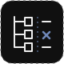

<p align="left">
  
</p>

# WatchConverge

[](LICENSE)
[](https://github.com/0then0/watchconverge/actions/workflows/ci.yml)

Check whether a file index still matches the disk after an atomic save, rename, deletion or recreation.

WatchConverge runs real filesystem operations in a temporary tree, requests the consumer's **existing cached view**, and compares it with an independent disk walk. Its verdict depends on state, not the number or order of watcher notifications. Use it to investigate stale indexes and build reproducible regression cases for indexers, development servers and file-sync tools.

## Quickstart

Install Node.js **22.18 or later** and npm. WatchConverge runs locally; no account, database or service is required.

```sh
git clone https://github.com/0then0/watchconverge.git
cd watchconverge
npm ci
npm run build
npm start
```

Open [http://127.0.0.1:4317](http://127.0.0.1:4317):

1. Select a scenario and a built-in or custom consumer.
2. Run it in a new temporary tree. Stop the run if necessary.
3. Inspect the operations, notifications, processing completions and disk/index comparison at each checkpoint.
4. Download the scenario, result JSON or standalone HTML report. The report opens offline without external assets.

The interface supports system, light and dark themes. One run is active at a time, and the server retains only the latest result. Export a result before starting another run; download links from stale tabs cannot silently export a newer result. Set `PORT` to change the loopback port.

## Command line

```sh
npm run --silent cli -- --list
npm run --silent cli -- --scenario atomic-save --adapter fixed --export
npm run --silent cli -- --scenario atomic-save --adapter broken --json
```

Use npm's `--silent` option when reading JSON from stdout. Running `node src/cli.ts` directly also produces clean JSON with `--json`.

`--export` writes `scenario.json`, `result.json` and `report.html` to a separate tool-owned OS temporary directory and prints its path to stderr. The scenario's working tree is removed on completion, cancellation or error. Export files remain until you remove them or the OS clears temporary storage.

To replay an exported scenario:

```sh
npm run --silent cli -- --scenario-file /absolute/path/to/scenario.json --adapter fixed --json
```

Each replay creates a fresh tree. Operations and content are reproducible; notification sequences and exact timings vary across operating systems.

CLI exit codes: `0` for PASS, `1` for DIVERGED, `2` for ERROR, NOT-READY or INCONCLUSIVE, `3` for STOPPED, and `4` for UNSUPPORTED. The broken consumer is expected to return `1` for the atomic-save example on Linux/macOS. Run `npm run --silent cli -- --help` for deadline options.

## Scenarios and consumers

The five built-in scenarios cover:

- Atomic replacement followed by another write at the same path.
- Deletion, recreation and a subsequent write.
- Directory rename followed by an edit to a nested file.
- Twenty consecutive overwrites, checking the final version.
- Deletion that must disappear from the consumer index.

The **broken consumer** watches the initial files with `fs.watch` and keeps those subscriptions after replacement. On Linux/macOS, a subscription can remain attached to the old inode ([Node's documented behavior](https://nodejs.org/api/fs.html#inodes)). Its replacement checkpoint can match while the next write leaves the index stale:

```text
Initial index                    MATCH
Atomic replacement · v1           MATCH
Write to replacement · v2         DIVERGED
  app.txt   content-mismatch
  disk      SHA-256(v2\n)
  index     SHA-256(v1\n)
```

The **fixed consumer** watches directories and treats notifications, including null filenames, as invalidations. It reconciles its cache on those invalidations. Linux/macOS use directory subscriptions; Windows uses a native recursive root subscription so watched child-directory handles do not prevent renames. Snapshot requests only serialize the cache. This small example is not a universal solution to watcher races, missing invalidations, overflows or concurrent writers. Neither consumer injects or artificially drops events. The inode demonstration is explicitly unsupported on Windows.

You can import a scenario in the UI or replay it from the CLI. See the [scenario format](docs/scenarios.md) for operations, validation and size limits.

## Connect an indexer

An adapter is a trusted local child process launched without a shell, with its working directory set to the new temporary tree. It runs with your permissions and is **not sandboxed**. It must leave fixture files unchanged and manage any children it creates.

```sh
npm run --silent cli -- --adapter-json '["node","/absolute/path/to/my-adapter.mjs"]' --json
```

In the UI, choose **Custom JSONL adapter** and enter the JSON argv array. Use absolute script paths and your shell's quoting rules; the example above uses POSIX shell quoting. Command arguments appear in result exports, so do not put secrets in them.

The [JSONL protocol](docs/protocol.md) defines readiness, request IDs, cached snapshots, diagnostics, processing observations and bounded shutdown. The [built-in consumers](src/adapters/demo.mjs) provide working examples. Wrap your indexer's snapshot API: a full scan triggered by a snapshot request can repair the state under test and invalidate the experiment. Keep stdout for protocol messages and stderr for logs.

## Interpret the result

The adapter declares a projection: relative POSIX paths, regular-file/directory types, SHA-256 file content and literal exclusion prefixes. The root entry is omitted. The same projection filters disk and index. Defaults include both types and exclude nothing; hidden files are not implicitly excluded. Symlinks are not followed, and special files are outside the file model. Permissions, timestamps, inode identity and other metadata are not checked.

Before scenario writes begin, the runner requires explicit readiness and a matching initial baseline. At each subsequent checkpoint, writes stop, the verifier walks the disk independently, and the runner samples the consumer cache.

- **PASS:** an idle snapshot matched within the observation window at every checked checkpoint. It does not prove continuous agreement between samples or correctness for other scenarios.
- **DIVERGED:** repeated idle snapshots still differed across a checkpoint's observation window. Differences identify missing paths, extra paths, content mismatches and type mismatches.
- **NOT-READY:** readiness timed out or a matching initial baseline was not established. Scenario writes did not start.
- **INCONCLUSIVE:** processing remained pending, a matching response arrived late, or too few idle snapshots arrived to establish repeated mismatches.
- **ERROR:** a process, filesystem, protocol, request-deadline or cleanup failure occurred. A nonzero adapter exit after acknowledging stop is still an error.
- **STOPPED / UNSUPPORTED:** the run was cancelled or unavailable on this platform. Neither means PASS.

A timeout alone does not prove event loss. Defaults are a 1,200 ms observation window, 1,500 ms snapshot-request deadline, 5,000 ms readiness deadline and 80 ms poll interval. A pending request may extend the checkpoint by its bounded deadline, but a late match cannot produce PASS. The overall run deadline is 120 seconds.

## External regression case: Bun #36328

[Bun #36328](https://github.com/oven-sh/bun/issues/36328) reports atomic-save destination notifications missing on Bun **1.3.14**. [PR #31830](https://github.com/oven-sh/bun/pull/31830) corrected duplicate suppression across distinct paths/event types.

A reproducible Linux arm64 probe uses actual release binaries and compares cached content with disk: Bun **1.3.14 diverged in 10/10 trials**, while **1.4.0 matched in 10/10**. The original Linux x86_64 environment and exact upstream canary build were not reproduced. See [the case study](docs/bun-36328.md) for revisions, immutable container images, commands and raw evidence. These results do not establish the earliest fixed release or a portable event sequence.

## Development and validation

```sh
npm ci
npx playwright install chromium
npm run validate
```

`validate` runs Biome, TypeScript 7, the Vite production build, Node tests and Chromium tests. Use `npm run dev` for the React/Vite development interface. [CONTRIBUTING.md](CONTRIBUTING.md) describes individual checks and the source layout; the [validation guide](docs/validation.md) explains platform coverage, isolated Linux tests and troubleshooting.

[CI](.github/workflows/ci.yml) checks Linux, macOS and Windows with Node 22 and 24. Unsupported cases have explicit skip reasons. Dependabot checks npm and GitHub Actions monthly, groups minor/patch updates, leaves major upgrades separate and limits open PRs. No automerge or security-update exclusion is configured.

## Scope and safety

Scenario operations have no target-directory option and run only in fresh tool-owned temporary trees. The server binds to `127.0.0.1`, rejects foreign Host/Origin requests and requires JSON plus a custom header for mutations. Adapter code remains trusted code with normal process permissions.

WatchConverge v0.1 handles regular files and directories on local filesystems. It does not provide a watcher backend, cloud service, kernel fault injection, network-filesystem testing or universal build-system validation. Normal completion, cancellation and error paths clean up the temporary tree; abrupt host termination or power loss can prevent cleanup. See [LICENSE](LICENSE) for Apache-2.0 terms.
